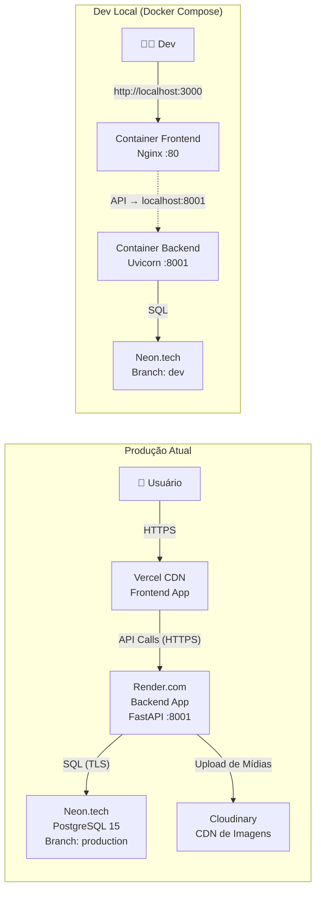

# Arquitetura de Referência — Padrão para Projetos Web Full-Stack

Documento atualizado com mapeamento detalhado da infraestrutura, ecossistema técnico, otimizações de performance e arquitetura de segurança Zero Trust. Este documento serve como **framework de referência genérico** (Estado da Arte) aplicável a qualquer projeto SaaS ou sistema corporativo.

---

## 1. Topologia do Sistema

### Resumo da Comunicação

| Camada | Tecnologia | Protocolo | Destino |
|--------|-----------|-----------|---------|
| Frontend → Backend | Axios (SPA) | HTTPS | `VITE_API_URL` (definido no build) |
| Backend → Banco | SQLAlchemy + psycopg2 | PostgreSQL (TLS) | `DATABASE_URL` |
| Backend → Cloudinary | SDK cloudinary | HTTPS | Uploads de Arquivos |
| Monitoramento | Sentry SDK | HTTPS | Frontend + Backend (DSNs separados) |
| Health Check | UptimeRobot | HEAD `/ping` | Mantém o Render.com acordado |

---

## 2. Visão Geral da Arquitetura e Regras de Negócio

A plataforma opera sob um modelo SPA (Single Page Application) no frontend, conectado a um backend modular.

### Isolamento Multi-Tenant e Ownership
- A arquitetura utiliza **Isolamento de Dados em Nível de Banco** implementado através de colunas como `empresa_id` ou `owner_id` distribuídas pelas tabelas.
- As operações usam informações do `current_user` extraídas do token JWT. A camada de Services (ou Repository) injeta essa variável em todas as queries (SQLAlchemy) para impedir vazamento de dados (Prevenção contra IDOR).

### Backend (Padrão Layered / DDD Tático)
- **Routers**: Contêm o mínimo de lógica. Injetam dependências (DB e `current_user`), chamam os services e delegam os payloads.
- **Schemas (Pydantic)**: A camada DTO valida as requisições de entrada (`Create`, `Req`) e formata os retornos (`Response`).
- **Services**: A orquestração real acontece aqui (CRUD, regras de negócios). O service interage com o banco de dados, isolando regras das rotas HTTP.

### Frontend (React SPA)
- Estrutura componetizada, dividida por domínio.
- Gerenciamento de estado global otimizado e separação clara entre componentes de apresentação e hooks de lógica.

---

## 3. Banco de Dados (PostgreSQL e SQLAlchemy)

O sistema utiliza ORM **SQLAlchemy** conectado a provedores serverless como **Neon.tech**.

### Resiliência de Conexão em Nuvem (Serverless Idle Timeout)

> [!TIP]
> **Trunfo de Infraestrutura:** Prevenção de quedas silenciosas por ociosidade (Evita o Erro 500).

Para tornar o backend resiliente às quebras de conexão provocadas unilateralmente por provedores cloud (Idle Timeout), o motor do SQLAlchemy (`create_engine`) deve ser configurado com duas estratégias vitais:
- **`pool_pre_ping=True`**: Realiza um micro-teste de latência (`SELECT 1`) antes de utilizar uma conexão da gaveta (pool). Se a porta estiver fechada, descarta a velha e abre nova.
- **`pool_recycle=300`**: Força a reciclagem proativa a cada 5 minutos na memória.

---

## 4. Performance e Otimização de Cache

### TanStack React Query (`useQuery`)
Toda a camada de fetching de dados do frontend utiliza cache inteligente (`@tanstack/react-query`).
- **Cache em memória**: Dados entregues instantaneamente.
- **Stale Time**: Reduz o "Over-fetching" (Múltiplas requisições da mesma informação num curto espaço de tempo).
- **Invalidação Cirúrgica**: `queryClient.invalidateQueries` garante a UI atualizada somente quando necessário.

---

## 5. Arquitetura de Segurança e RBAC (Zero Trust)

Implementamos uma postura Zero Trust baseada no princípio do menor privilégio.

### Matriz de Permissões (Slugs Granulares)
Ações sensíveis exigem uma permissão explícita verificada tanto no UI quanto na API (Dupla Blindagem).

- **Frontend (`useCan`)**: Oculta condicionalmente botões destrutivos ou fluxos.
- **Backend (`API Guard`)**: Dependências como `verificar_permissao` nas rotas do FastAPI interceptam requisições não autorizadas, prevenindo **Ataques Verticais** e **IDOR** antes que a lógica de negócio execute.

---

## 6. Segurança Extrema: Checklist Pré-Deploy e Best Practices

Para evitar as vulnerabilidades mais comuns encontradas em aplicações geradas via IA (as infames "5 vacilações de segurança"), as seguintes práticas são obrigatórias:

### 6.1. RLS Equivalente / Filtro de Dono em Toda Query
Nunca se confia no ID passado pelo usuário para atualizar ou ler algo sem verificar quem está solicitando.
- **Proteção contra IDOR:** Ao invés de um simples `WHERE id = :id`, queries backend devem **sempre** ser `WHERE id = :id AND owner_id = :current_user_id`. Isso atua como um Row-Level Security via lógica da aplicação.

### 6.2. Regras e Validações Centralizadas no Servidor
O Frontend não é uma barreira de segurança confiável. 
- Qualquer decisão de se o usuário é "admin" ou tem acesso a algo deve ser conferida nos bastidores. A interface apenas esconde os elementos para UX, não para proteção real.

### 6.3. Gestão Segura de Segredos e Variáveis de Ambiente
Nenhum segredo (`SECRET_KEY`, Database URL, ou chaves de API externas) pode vazar ou ir pro frontend.
- **Backend for Frontend (BFF)**: O front chama a nossa própria API, e o backend usa a chave mestra secreta para chamar a API de terceiro.
- O `.env` fica blindado no `.gitignore` e não vai pro repositório. Arquivos como `.env.example` são fornecidos com dados em branco.

### 6.4. Hashing de Senhas e Autenticação Robusta
- Senhas NUNCA são salvas em plaintext. Utiliza-se `passlib[bcrypt]` para geração do hash.
- O token de acesso tem uma expiração restrita (`ACCESS_TOKEN_EXPIRE_MINUTES`).

### 6.5. Validação Extrema e Sanitização (Input)
- Todo endpoint exige um schema Pydantic, que valida tipo de dados e formatos.

---

## 7. Hardening: HTTP Headers e Mitigação de Ataques Web

### 7.1. Rate Limiting
Prevenção de ataques de força-bruta e exaustão de recursos.
- O framework `slowapi` protege rotas críticas (como login e reset de senha) limitando o número de tentativas (ex: `5/minute`).

### 7.2. CORS (Cross-Origin Resource Sharing)
A política permissiva de CORS (ex: `allow_origins=["*"]`) é vetada em produção.
- Uma whitelist explícita deve ser passada via variável de ambiente `ALLOWED_ORIGINS` contendo apenas as URLs seguras (ex: domínio da Vercel).

### 7.3. Security Headers Middleware
Todos os responses do servidor recebem cabeçalhos de proteção avançada:
- `Strict-Transport-Security`: (HSTS) força conexão segura.
- `X-Frame-Options: DENY`: Evita Clickjacking.
- `X-Content-Type-Options: nosniff`: Previne *MIME Sniffing*.
- `X-XSS-Protection`: Defesa extra contra injeções.

---

## 8. Ferramentas de Auditoria

Para varredura regular, integramos ao fluxo as ferramentas:
- **Gitleaks**: Impede que API Keys ou senhas fiquem no histórico do repositório (commits antigos).
- **Bandit (Python)**: Análise SAST das regras locais em busca de strings expostas, SQL injection bruto, etc.
- **OWASP ZAP**: Validações ativas contra o sistema para rastrear brechas no ar.
