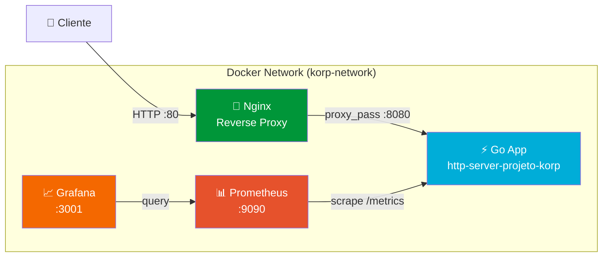

# 🚀 Projeto Korp — Desafio DevOps

Serviço HTTP em **Golang** com infraestrutura containerizada (**Docker**), monitoramento (**Prometheus + Grafana**) e automação completa via **Ansible**.

---

## 📐 Arquitetura



### Fluxo de Dados

| De | Para | Protocolo | Propósito |
|----|------|-----------|-----------|
| Cliente | Nginx (:80) | HTTP | Ponto de entrada único |
| Nginx | Go App (:8080) | HTTP (interno) | Proxy reverso |
| Prometheus | Go App (:8080/metrics) | HTTP (interno) | Coleta de métricas |
| Grafana | Prometheus (:9090) | HTTP (interno) | Consulta de métricas |

> **Nota de segurança:** O Go App não expõe portas ao host. Só é acessível via rede interna Docker.

---

## 🏗️ Estrutura do Projeto

```
.
├── go-app/                          # Aplicação Go
│   ├── main.go                      # Servidor HTTP com métricas Prometheus
│   ├── go.mod                       # Módulo Go e dependências
│   └── Dockerfile                   # Multi-stage build (19.8MB)
├── nginx/
│   └── conf.d/
│       └── http-server-projeto-korp.conf  # Proxy reverso + Security Headers
├── prometheus/
│   └── prometheus.yml               # Configuração de scraping
├── grafana/
│   ├── provisioning/
│   │   ├── datasources/datasource.yml     # Auto-config Prometheus
│   │   └── dashboards/dashboards.yml      # Auto-discovery de dashboards
│   └── dashboards/
│       └── http-server-projeto-korp-dashboard.json  # Dashboard pré-configurado
├── ansible/
│   ├── playbook.yml                 # Playbook principal (um comando)
│   ├── inventory/hosts.yml          # Inventário de hosts
│   ├── group_vars/all.yml           # Variáveis globais
│   └── roles/
│       ├── docker/tasks/main.yml    # Instalação/verificação do Docker
│       ├── app/tasks/main.yml       # Build e deploy da aplicação
│       └── monitoring/tasks/main.yml # Validação do monitoramento
├── docker-compose.yml               # Orquestração de 4 containers
├── Makefile                         # Atalhos para comandos comuns
├── .github/
│   ├── workflows/ci.yml            # Pipeline CI/CD
│   └── dependabot.yml              # Atualização automática de deps
└── README.md
```

---

## ⚡ Início Rápido

### Pré-requisitos

- Docker e Docker Compose
- Ansible (para provisionamento automatizado)
- Linux (nativo ou WSL2)

### Opção 1: Docker Compose (manual)

```bash
docker compose up -d --build
curl http://localhost:80/projeto-korp
```

### Opção 2: Ansible (automático — recomendado)

```bash
ansible-playbook -i ansible/inventory/hosts.yml ansible/playbook.yml
```

Este comando único:
1. ✅ Verifica/instala Docker
2. ✅ Cria a rede Docker bridge
3. ✅ Builda a imagem do Go app
4. ✅ Sobe todos os containers via Docker Compose
5. ✅ Configura Nginx como proxy reverso
6. ✅ Configura Prometheus + Grafana com dashboard automático
7. ✅ Valida o serviço via requisição HTTP e exibe a resposta

### Resultado Esperado

```json
{
    "nome": "Projeto Korp",
    "horario": "2026-09-08T19:40:44Z"
}
```

---

## 📊 Monitoramento

### Métricas Implementadas

| Métrica | Tipo | Descrição |
|---------|------|-----------|
| `up{job="http-server-projeto-korp"}` | Gauge | Disponibilidade do serviço (1=UP, 0=DOWN) |
| `http_requests_total` | Counter | Total de requisições (labels: method, path, status) |
| `http_request_duration_seconds` | Histogram | Latência das requisições (p50, p90, p95, p99) |

### Dashboard Grafana (provisionado automaticamente)

O dashboard contém **8 painéis**:

1. **🟢 Status do Serviço** — UP/DOWN em tempo real
2. **📊 Total de Requisições** — Contador absoluto
3. **⚡ Taxa de Requisições** — Requests por segundo
4. **🕐 Latência p95** — 95% das requests abaixo deste tempo
5. **📈 Requisições por Segundo (timeline)** — Gráfico temporal por status HTTP
6. **🕐 Latência por Percentil (timeline)** — p50/p90/p99 ao longo do tempo
7. **📊 Requisições por Endpoint** — Volume por rota
8. **⏱️ Disponibilidade (timeline)** — Histórico UP/DOWN

### Acessar

| Serviço | URL | Credenciais |
|---------|-----|-------------|
| API | http://localhost/projeto-korp | — |
| Prometheus | http://localhost:9090 | — |
| Grafana | http://localhost:3001 | Acesso anônimo habilitado |

---

## 🔒 Decisões de Segurança

Adições além do escopo mínimo, baseadas em boas práticas:

| Prática | Implementação | Referência |
|---------|--------------|------------|
| **Non-root container** | `USER appuser` no Dockerfile | Princípio do menor privilégio |
| **Multi-stage build** | Imagem final de 19.8MB (vs ~800MB) | Redução de superfície de ataque |
| **Security Headers** | 5 headers no Nginx (CSP, X-Frame-Options, etc.) | OWASP Best Practices |
| **Read-only volumes** | `:ro` em todos os volume mounts | Defesa em profundidade |
| **Graceful shutdown** | `signal.NotifyContext` no Go | Zero-downtime deploys |
| **Health checks** | Docker healthcheck + `/health` endpoint | Auto-recuperação |
| **Server timeouts** | Read/Write/Idle timeouts configurados | Proteção contra Slowloris |
| **CI/CD Pipeline** | GitHub Actions com lint, build e test | Automação de qualidade |
| **Dependabot** | Atualização automática de Go, Docker e Actions | Manutenção de segurança |

---

## 🎯 Decisões Técnicas e Tradeoffs

### Por que `net/http` (stdlib) ao invés de um framework?
Para um endpoint simples, a biblioteca padrão é suficiente e demonstra entendimento dos fundamentos. Zero dependências externas além do Prometheus client.

### Por que Alpine ao invés de Scratch?
Alpine adiciona ~7MB mas inclui shell para debug e certificados TLS. O custo é desprezível e o benefício operacional é significativo.

### Por que Ansible com detecção inteligente de Docker?
O playbook verifica se Docker já existe antes de instalar. Funciona tanto em máquinas limpas quanto em ambientes com Docker Desktop (WSL2), tornando-o mais robusto.

### Por que provisioning automático do Grafana?
Dashboards e datasources provisionados via arquivos YAML/JSON eliminam configuração manual e garantem reprodutibilidade. Infrastructure as Code de ponta a ponta.

---

## 🛠️ Comandos Úteis (Makefile)

```bash
make up         # Subir todos os containers
make down       # Derrubar tudo
make test       # Testar endpoints e métricas
make logs       # Ver logs em tempo real
make provision  # Provisionar via Ansible
make traffic    # Gerar tráfego para popular métricas
make clean      # Limpar tudo (containers + imagens)
```
